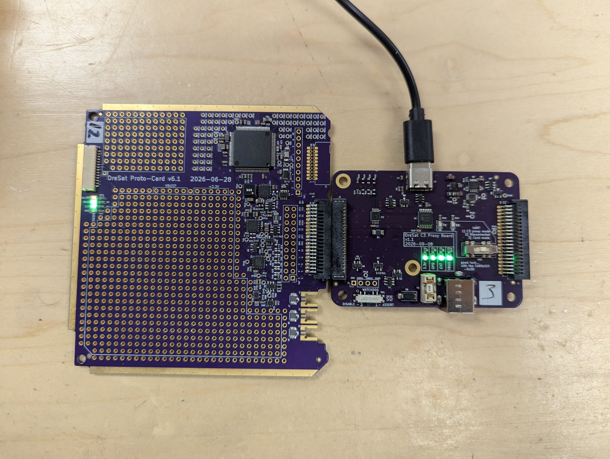
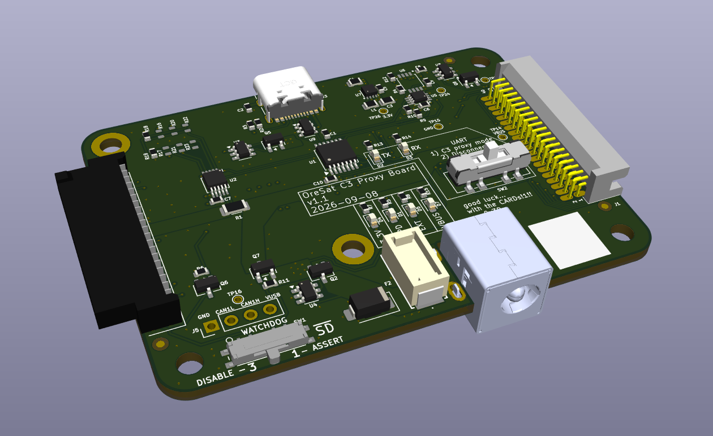
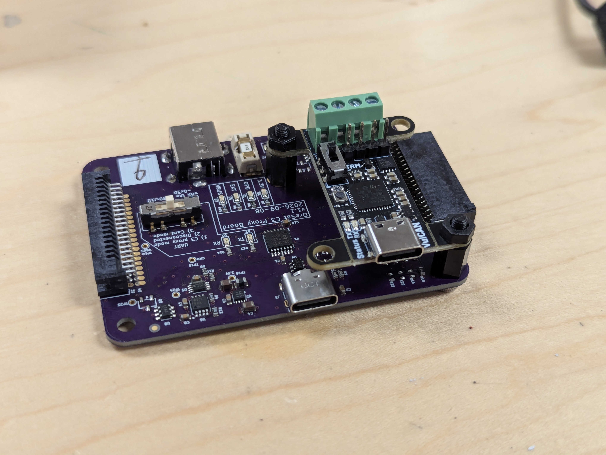

## Introduction

## Quick Start

A python virtual environment is recommended for using this project.

### Software Dependencies

requires the `gpiodetect` command, usually from the `gpiod` package.
`dnf install libgpiod-utils`
requires access to the `udevadm` command.
`dnf install systemd-udev`

### Client configuration (linux)

Create udev rule to allow applications to access the c3-proxy from userspace.

```bash
echo 'SUBSYSTEMS=="usb", ACTION=="add", ATTRS{idVendor}=="04d8", ATTRS{idProduct}=="00dd", TAG+="uaccess", MODE="0666"' | sudo tee /etc/udev/rules.d/70-mcp2221a.rules
```
Then reload udev rules so it goes into effect
```bash
sudo udevadm control --reload
```
It may be necessary to restart your computer, if the above command doesn't work.


### Installing and Setup

Install the package locally (also do this to update packages).
```bash
pip install -e ./
```
#### Configuring the flash (once per board)
Each c3-proxy needs to have it's flash configured to set the functionality of the gpio pins.
This can be done with the `configure.py` script.
```
python oresat_c3_proxy/configure.py
```
This only needs to be done once per board.

### Using the software

```bash
python -m oresat_c3_proxy
```
start the software, saving all data csv file
```bash
python -m oresat_c3_proxy path/to/my.csv
```
csv data includes the date and time to allow for long tests

#### user interface
- In the `Chip Selector` panel, press the `REFRESH` button at the bottom to detect connected c3-proxy boards.
    If there are multiple c3-proxys connected over usb, then you can select which one you want to interact with by clicking on it's row.
- in the `Opd Menu` panel, press `scan` to detect all the OPD consumers connected to the selected c3-proxy.
once a card is recognized, 4 OPD functions can be toggled.
    - **EN** or enable, tells the OPD circuit to allow the card draw power from the bus.
    - **ISP** or in-system-programming, puts the cards micro controller into ISP mode, helpful for flashing in some cases.
    - **UART** selects this card for UART communication
    - **B-RESET** when asserted the circuit breaker is reset, turn of during normal use
- In the `Graph Pane` the current, voltage, and power can be seen over time. The graph can be moved with the mouse, and scaled by scrolling on the axis.


### pictures





